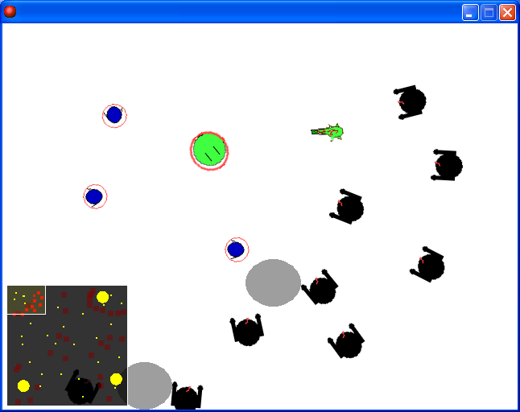

# Zombie Assault

[한국어](README.ko.md)

An action game where you fight mutating zombie hordes, switching between a sword and a gun. Made for a GameMaker community event.

  

## How to play

Download from Releases, extract and run. The opening video has to be in the same folder as the game, so extract the whole folder.

Move with WASD, aim and attack with the mouse, and switch between the sword and the gun with 1 and 2. A zombie that touches the virus roaming the map mutates. There is a minimap in the bottom left of the screen.

## Files

| Path | Contents |
|---|---|
| `source/zombie-assault.gmk` | Original project file |
| `source/split/` | Text tree produced by GmkSplitter |
| `docs/screenshots/` | Screenshots |
| Releases | Distribution files |

## Credits

The `scr_MDXMAP_*` scripts under `source/split/Scripts/` are the MDX-Minimap library by Midx.

## License

CC BY-NC-ND 4.0. Unmodified copies may be shared for noncommercial purposes with attribution. Distributing modified versions and commercial use are not allowed. Bundled libraries, graphics, sounds, and maps made by other people keep their own rights. See [LICENSE](LICENSE).
